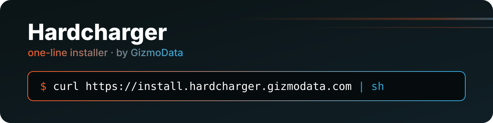

<p align="center">
  <a href="https://gizmodata.com">
    
  </a>
</p>

<p align="center">
  <a href="https://github.com/gizmodata/hardcharger-install/actions/workflows/deploy.yml"></a>
  <a href="https://github.com/gizmodata/hardcharger-install/actions/workflows/test-install.yml"></a>
  <a href="https://github.com/gizmodata/hardcharger"></a>
  <a href="LICENSE"></a>
  <a href="https://gizmodata.com"></a>
</p>

# 🏎️ hardcharger-install

The one-line installer for [Hardcharger™](https://github.com/gizmodata/hardcharger), served at
<https://install.hardcharger.gizmodata.com>. It installs `hardcharger-server` and the `hardcharger`
client, keeps every version you install side by side, and switches between them in seconds.

## ⚡ Install

**macOS (Apple silicon) and Linux (x86-64, arm64, glibc)**

```bash
curl https://install.hardcharger.gizmodata.com | sh                              # latest
curl https://install.hardcharger.gizmodata.com | HARDCHARGER_VERSION=0.2.0 sh    # a given version
```

Plain `http://` works too, and neither needs `-L`: the script itself is served at `/`, as
`text/plain`.

**Windows (PowerShell)**

```powershell
irm https://install.hardcharger.gizmodata.com/install.ps1 | iex
$env:HARDCHARGER_VERSION = '0.2.0'; irm https://install.hardcharger.gizmodata.com/install.ps1 | iex
```

Windows builds aren't released yet. Until a release has `hardcharger-windows-<arch>.zip`,
`install.ps1` says so and exits non-zero.

> 🔐 **While Hardcharger's releases are internal** (until public launch), the installer needs a
> GitHub token that can read `gizmodata/hardcharger`. It uses `HARDCHARGER_INSTALL_TOKEN`, then `GH_TOKEN`, then
> `gh auth token` if the GitHub CLI is signed in, so `gh auth login` is all most people need:
>
> ```bash
> curl https://install.hardcharger.gizmodata.com | HARDCHARGER_INSTALL_TOKEN="$(gh auth token)" sh
> ```
>
> The token is handed to `curl` in a file and is never printed or put on a command line. Once the
> releases are public, no token is needed.

## 🔀 Switch, list, uninstall

```bash
curl https://install.hardcharger.gizmodata.com | HARDCHARGER_VERSION=0.1.2 sh    # downgrade
curl https://install.hardcharger.gizmodata.com | HARDCHARGER_VERSION=0.2.0 sh    # back again: no download
curl https://install.hardcharger.gizmodata.com | sh -s -- --list                 # installed versions
curl https://install.hardcharger.gizmodata.com | sh -s -- --uninstall 0.1.2      # remove one version
curl https://install.hardcharger.gizmodata.com | sh -s -- --uninstall            # remove everything
```

| Option (`sh -s -- …`) | Environment | |
|---|---|---|
| `--version <v>` | `HARDCHARGER_VERSION` | `latest` (default), `X.Y.Z` or `vX.Y.Z` |
| `--prefix <dir>` | `HARDCHARGER_PREFIX` | install root, default `~/.hardcharger` |
| `--list` | | installed versions, the current one starred |
| `--uninstall [<v>]` | | remove one version, or the whole prefix |
| `--modify-path` | | add `<prefix>/bin` to your shell's startup file (otherwise the line is only printed) |
| | `HARDCHARGER_INSTALL_TOKEN` | GitHub token; `none` downloads anonymously |
| | `HARDCHARGER_INSTALL_MIRROR` | a directory or URL laid out like the releases (`vX.Y.Z/<asset>`, `vX.Y.Z/SHA256SUMS`) |

`install.ps1` takes the same options as `-Version`, `-Prefix`, `-List`, `-Uninstall [-Version v]`
and `-ModifyPath`.

## 🗂️ Layout

```text
~/.hardcharger/
├── versions/
│   ├── 0.1.2/   bin/ lib/ …    every installed version, as its release tarball has it
│   └── 0.2.0/   bin/ lib/ …
└── bin/
    └── hardcharger-server -> ../versions/0.2.0/bin/hardcharger-server   (and hardcharger, when the version has it)
```

Put `~/.hardcharger/bin` on your `PATH` (the installer prints the exact line). On Windows,
`%USERPROFILE%\.hardcharger\bin` is a junction to the current version's `bin\`.

## 🛡️ What it checks

- **The platform, before downloading.** It refuses musl (Alpine), Intel Macs, and 32-bit systems
  (on a Raspberry Pi it tells you to install the 64-bit Raspberry Pi OS). It reads the system's
  glibc version and compares it with what the release needs: releases up to 0.2.0 need glibc 2.38
  (a table in `install.sh`, since releases don't publish this yet). Builds for glibc 2.28 (Debian 12,
  Raspberry Pi OS Bookworm, RHEL/Oracle Linux 8) come in a later release.
- **The download.** It checks the tarball against the release's `SHA256SUMS` when the release
  has one, and against GitHub's own SHA-256 digest of the asset. It refuses a mismatch.
- **The binaries, before switching.** Every executable must run `--version` (and the build's real
  `GLIBC_` symbols must fit the system) before the current version changes. A failed download,
  checksum or check leaves the previous version current.

Releases before 0.2.0 named the server `hardcharger` (the client's name since 0.2.0). The installer
installs those as `hardcharger-server`, so that name always means the server.

## 🧪 Tests

[`test-install.yml`](.github/workflows/test-install.yml) runs on every pull request and push, when
hardcharger publishes a release (`repository_dispatch: hardcharger-released`), and weekly. Its jobs
come in two kinds.

**Fixture tests, which gate the deploy.** They need no credentials and no real release.
[`fake_github.py`](.github/scripts/fake_github.py) serves fixture releases (stand-in tarballs, zips
and `SHA256SUMS`) at the same API, redirect and download paths GitHub uses. It runs twice: once
"internal" (token required) and once "public".

| Job | Where | What |
|---|---|---|
| lint | ubuntu-24.04 | shellcheck, `dash -n`, `bash -n`, PSScriptAnalyzer, and the platform checks with a fake `uname`/`getconf`/`ldd` (32-bit Pi, musl, Intel Mac, old glibc, …) |
| fixtures linux-amd64, linux-arm64, macos-arm64 | ubuntu-24.04 (dash and bash), ubuntu-24.04-arm, macos-15 | latest and pinned installs, with a token and anonymously; the token reaching the API but never the storage host; `GH_TOKEN` and `gh auth token`; a downgrade to a pre-0.2.0 layout and a switch back with no download; `--list`; good, corrupted and missing checksums and a wrong GitHub digest; a build that doesn't run; a release with no asset for this platform; API rate-limit fallbacks; `--modify-path`, `--prefix`, every uninstall |
| fixtures windows-amd64, windows-arm64 | windows-2025, windows-11-arm (PowerShell 7 and 5.1) | the same with stand-in `.exe` builds, plus "Windows builds are coming" for a release with no zip, both as a file and through `iex` |
| glibc message | debian:12 (arm64, the Raspberry Pi OS Bookworm base), oraclelinux:8 | 0.2.0 is refused with the glibc explanation, before any download |

**The real-release check: `real release, runs at public launch (…)`.** These jobs install the real
latest release on Linux, macOS, Debian 13, Debian 12, Oracle Linux 8 and Windows, then start the
server and query it. While hardcharger's releases are internal (an anonymous request to github.com
gets 404), they post a notice, "releases are internal; real-release check runs at public launch",
and pass. **That pass is not coverage.** Once the releases are public, the jobs run for real and
must pass, with no flag to flip. The Debian 12 and Oracle Linux 8 entries are `continue-on-error`
until the glibc 2.28 builds ship.

Run them locally (each uses a throwaway `HOME`):

```bash
.github/scripts/fixture-scenarios.sh                                   # SH=dash or SH=bash to pick the shell
.github/scripts/platform-tests.sh dash
HARDCHARGER_INSTALL_TOKEN="$(gh auth token)" .github/scripts/scenarios.sh   # the real-release check
```

## 🚦 At public launch

Flips by itself, the moment gizmodata/hardcharger's releases are public:

- Anonymous installs work. No token is needed, and the "while the releases are internal" hints
  stop appearing, because no request gets the 404 that triggers them.
- The `real release, runs at public launch` jobs start running for real on the next push or weekly
  run, and every deploy then also depends on them.

Check by hand:

- [ ] On a machine with no `GH_TOKEN` and gh not signed in, run
      `curl https://install.hardcharger.gizmodata.com | sh`. It should install the latest release,
      and `hardcharger-server --version` should run.
- [ ] Run Deploy (or push to main). Its `real release, runs at public launch` jobs must show the real
      install steps running, not the "not run" notice.
- [ ] Windows: once a release has `hardcharger-windows-<arch>.zip`, check that
      `irm https://install.hardcharger.gizmodata.com/install.ps1 | iex` installs it, and that the
      Windows real-release job queries the server.
- [ ] Remove the internal-release wording from this README and from the installers' token hints.

## 🚀 Deploy

[`deploy.yml`](.github/workflows/deploy.yml) runs on every push to `main`. Only after the tests
pass does it upload `install.sh` (served at `/`) and `install.ps1` as `text/plain` to the private
S3 bucket `gizmodata-hardcharger-install`. It then invalidates CloudFront distribution `E1RQCZI4UV7Y9O`
and checks that the live https and http URLs serve exactly this commit's files. It reaches AWS by GitHub
OIDC, with a role that trusts only this repo's `main` and can only write that bucket and invalidate
that distribution. The bucket, distribution, certificate, DNS and role are in
[gizmodata-infrastructure-terraform](https://github.com/gizmodata/gizmodata-infrastructure-terraform)
(`aws/dns/hardcharger_install.tf`).

## 📄 License

[Apache 2.0](LICENSE), like Hardcharger.

<p align="center">
  <a href="https://gizmodata.com"></a><br>
  <sub>Built by <a href="https://gizmodata.com">GizmoData™</a></sub>
</p>

<p align="center"><sub>Hardcharger™ and GizmoData™ are trademarks of GizmoData LLC.</sub></p>
